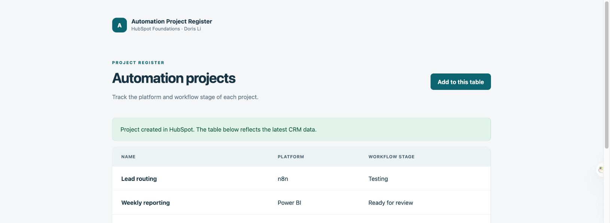

# Automation Project Register — HubSpot Foundations Practicum

A Node.js application for tracking automation projects in a HubSpot developer test account. Built from the official HubSpot Academy starter using Express, Axios, dotenv and Pug.

## Data model

Each project has three text properties: **Name** (`name`), **Platform** (`platform`) and **Workflow stage** (`workflow_stage`). Only synthetic demonstration projects are used.

Developer test account: **Doris Li IWH I Practicum**, ID **247969085**. Custom object type: **2-271654966**.

[Open the Automation Projects list in the developer test account](https://app-na2.hubspot.com/contacts/247969085/objects/2-271654966/views/all/list).

The schema defines a bidirectional association with the Contacts object (`0-1`). All three custom properties are strings; Name is the primary display property.

## Local setup

1. Use Node.js 22 or later and run `npm ci`.
2. Copy `.env.example` to `.env`.
3. Set `HUBSPOT_PRIVATE_APP_TOKEN` and `HUBSPOT_OBJECT_TYPE` from the developer test account.
4. Run `npm start` and open <http://127.0.0.1:3000>.

Never commit `.env` or an access token. The server uses the token without sending it to a Pug template or browser. The server listens on loopback by default.

## Required routes

| Method | Route | Behavior |
| --- | --- | --- |
| GET | `/` | Read HubSpot records and render `homepage.pug` as a table. |
| GET | `/update-cobj` | Render `updates.pug` with a form for the three properties. |
| POST | `/update-cobj` | Validate, create a CRM record through the API and redirect to the table. |

The table supports the HubSpot paging cursor. The form preserves values when validation or the API fails. Error messages do not expose credentials or request headers.

## Validation

Run `npm test` for HTTP integration tests using the real Express routes and Pug views with an isolated fake HubSpot transport. These tests do not claim live API verification. Live verification completed on 2026-11-11:

- Created the custom schema and its association with Contacts through the HubSpot API.
- Seeded three distinct project records and loaded them in the homepage table.
- Opened `/update-cobj` in a browser, entered **Support ticket triage / Zapier / Prototype**, and submitted the form.
- Confirmed HTTP 303 redirected to the homepage, where a fresh HubSpot GET displayed the fourth record.
- Seven automated HTTP tests passed, including validation, error handling, escaping, paging and CSRF rejection.

The optional `node scripts/setup-test-account.js` helper provisions the schema and sample records. It verifies the token belongs to test account 247969085 before writing; it will refuse a different account. It does not delete records or modify production accounts.

## Attribution and submission

Forked from [HubSpot Academy's official practicum starter](https://github.com/HubSpot-Academy/integrating-with-hubspot-i-foundations-practicum). Implementation and verification were prepared with Codex assistance; the learner should review and understand the source before submitting it under the course's own-work requirement.

This repository is the submission artifact. No public deployment is required. Certification depends on HubSpot's manual review.
